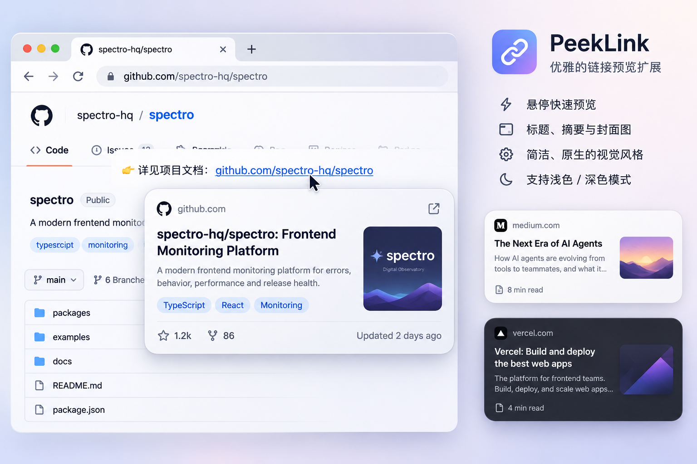

# PeekLink v1.0.0

Chrome MV3 link-preview extension, macOS + Arc hybrid style.



## Features

- Floating metadata cards with title, description, favicon, and cover image.
- Optional Option (Alt) + Hover trigger and a configurable 0–3000ms delay.
- Per-site allowlist and blocklist rules, including subdomain matching.
- One-time all-website authorization or individual website grants and revocation.
- Dynamic content-script registration limited to granted origins.
- In-flight request deduplication, four-request concurrency limit, and a bounded queue.
- In-memory LRU cache: 15 minutes for successful previews and 30 seconds for failures.
- Timeouts, HTML type validation, a 400KB streaming response cap, and readable errors.
- Optional interactive webpage previews in a sandboxed, credentialless iframe.
- X-Frame-Options and CSP frame-ancestors detection with metadata fallback.
- Branded toolbar and extension icons in 16, 32, 48, and 128px sizes.
- Automated unit tests, CI verification, and tagged GitHub Release packaging.

## Requirements

- Node.js >= 22
- npm >= 10

## Development

```bash
npm install
npm run dev
```

Keep the development server running while using a development build. For a production build:

```bash
npm run typecheck
npm test
npm run build
```

Open `chrome://extensions`, enable Developer mode, then load `.output/chrome-mv3` after building.

## Website access

Click the PeekLink toolbar icon to open settings, then click **Enable on all websites** for a one-time Chrome authorization. Reload any already-open tabs. You can still restrict pages with the allowlist and blocklist. For granular control, use the individual website grant instead. PeekLink dynamically registers its preview script only for granted origins and checks both the containing page and destination grants at the message boundary; removing a grant prevents future activations and metadata requests.

Website rules apply to the page containing the link. A rule such as `example.com` also matches its subdomains. The blocklist takes precedence; a non-empty allowlist disables all unlisted pages.

## Interactive webpage previews

Open settings and set **Preview mode** to **Interactive webpage**. PeekLink reuses the metadata response to check embedding policy before creating an iframe. Use the **Metadata** button in the preview header to switch an individual preview back to its card, or open the destination in a new tab at any time.

## Tests

```bash
npm test
```

The suite covers metadata parsing, website rules, permission patterns, and iframe embedding policies. CI runs type checking, tests, and a production build for pushes to `main` and pull requests.

## Release

To create a Chrome Web Store upload package locally:

```bash
npm run zip
```

The ZIP is written under `.output/`. Pushing a tag matching `v*.*.*` runs the release workflow, verifies the project, packages the extension, and creates a GitHub Release with the ZIP attached. Chrome Web Store submission remains a separate reviewed step; store credentials are not stored in this repository.

## Notes

- WXT 0.21.5, TypeScript 7.0.2, Vite 8, and Vitest 5.
- Uses `#imports` for WXT entrypoint definitions.
- Remote pages may block fetches or lack metadata. Redirected metadata requests are currently rejected rather than followed.
- Webpage mode is experimental. Frames use an opaque origin without `allow-same-origin`; sites that require origin storage, authenticated frames, frame-busting scripts, or fail to load within 12 seconds may fall back to metadata.
- Private/local hostname and IP-literal targets are rejected. Browser extension fetch APIs do not expose resolved IP addresses, so URL checks alone cannot fully prevent DNS-rebinding attacks.
- Metadata images still load directly with `referrerPolicy="no-referrer"`; background image proxying remains future privacy work.
- The cache is memory-only and resets when the extension service worker stops.
